# Path Generator on finite truchet tilings

A real-time C++23 and OpenGL project for generating Truchet paths across various grid topologies. It creates both non-crossing tracks and overlapping ribbons on Hexagonal ($6^3$), Octagonal–Square ($4.8^2$), and Dodecagonal–Hexagonal–Square ($4.6.12$) grids. Using DSU cycle merging, it can generate multiple randomized circuits or connect everything into a single continuous loop, rendered in real time with fragment shaders.

## Gallery

| Topology | Non-Overlapping · Single Loop | Non-Overlapping · Multi-Loop | Overlapping · Single Loop | Overlapping · Multi-Loop |
| :--- | :---: | :---: | :---: | :---: |
| **Dodecagonal**<br>($4.6.12$) | 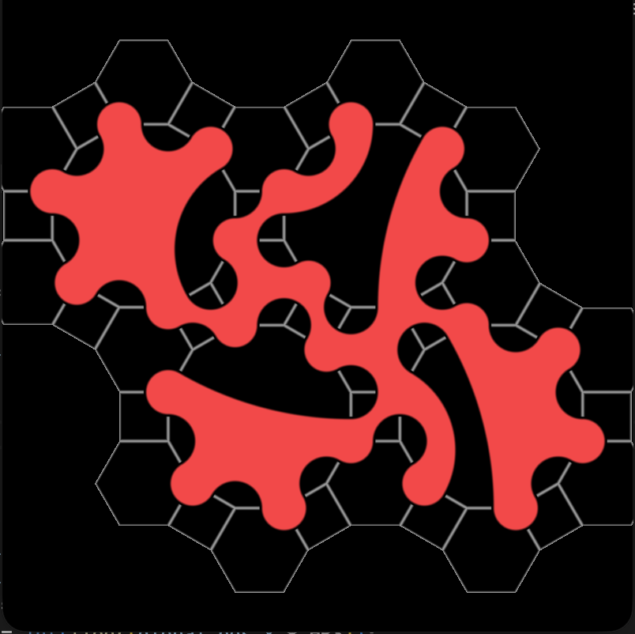 | 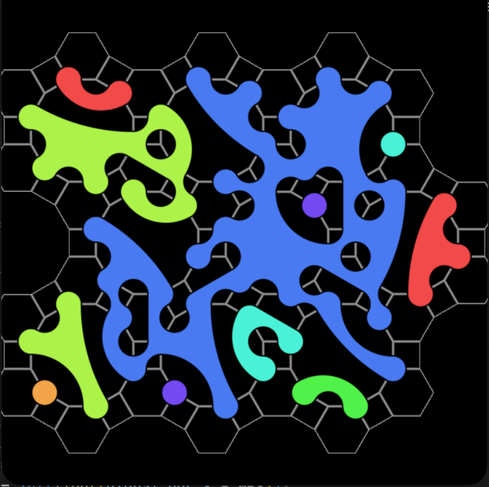 | 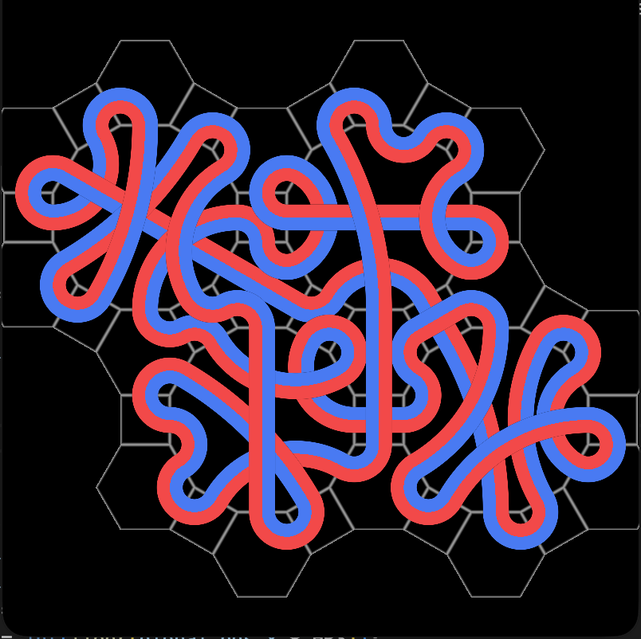 | 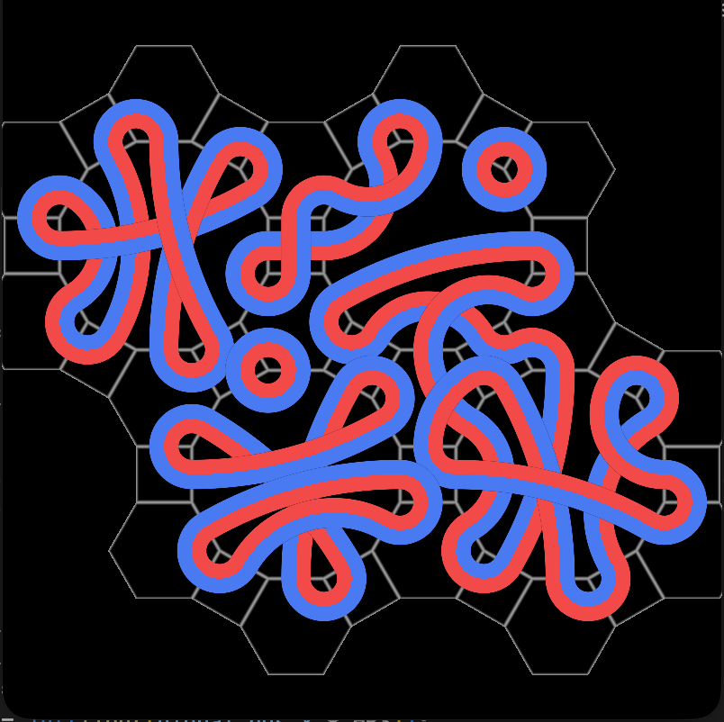 |
| **Octagonal**<br>($4.8^2$) | 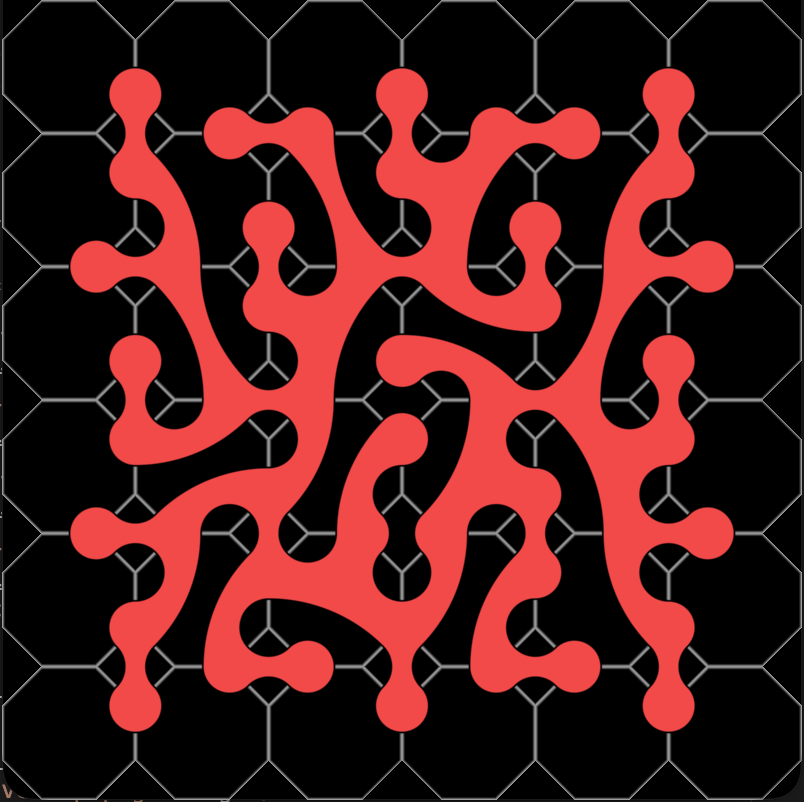 | 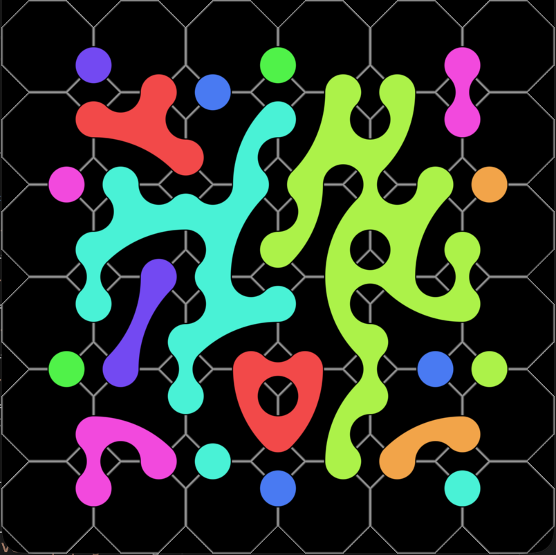 | 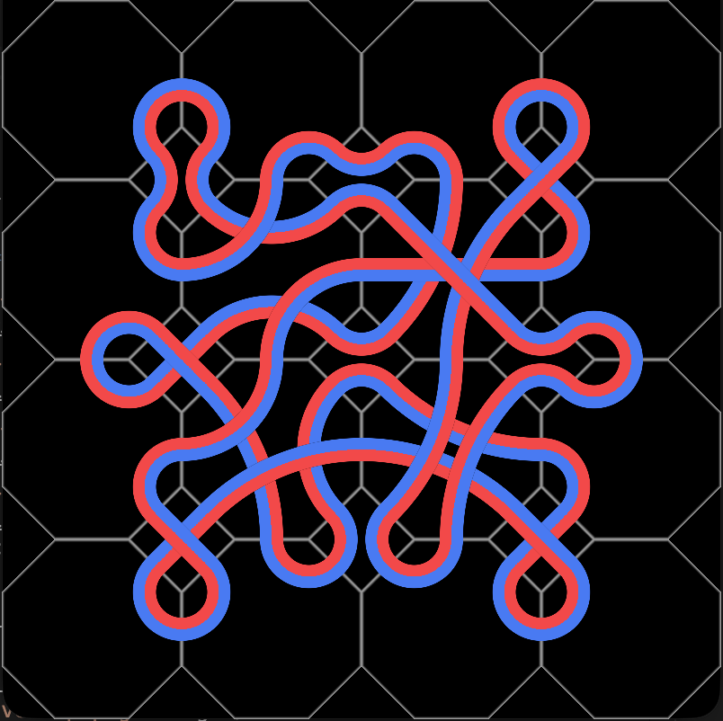 | 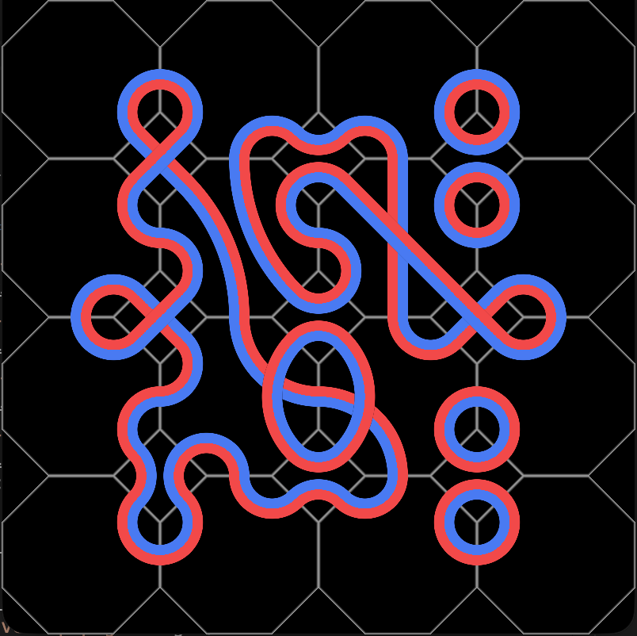 |
| **Hexagonal**<br>($6^3$) | 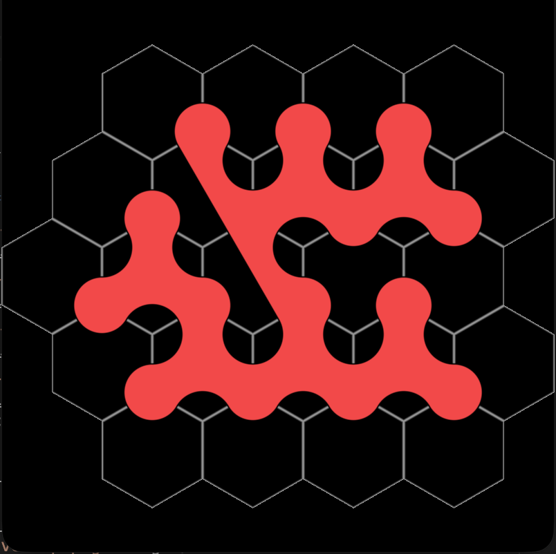 | 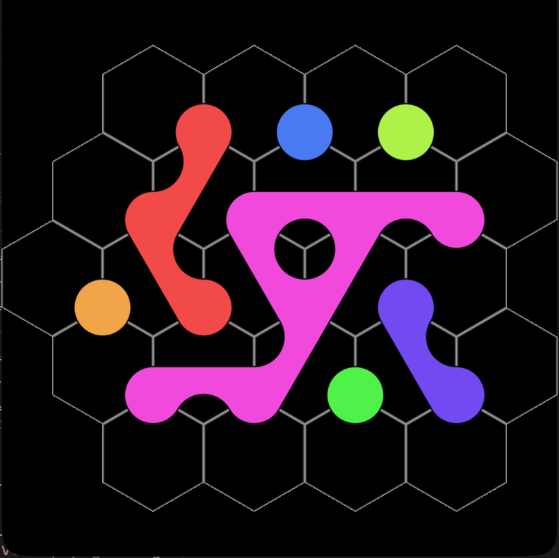 | 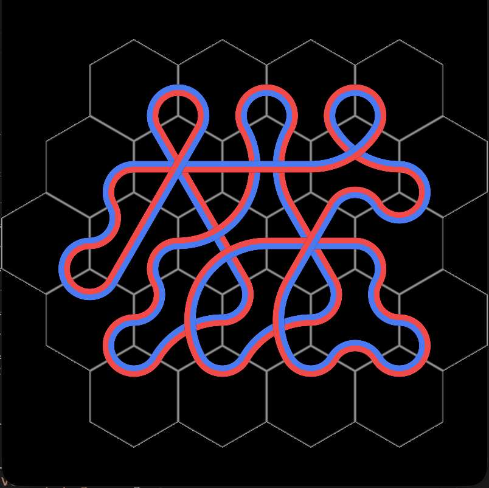 | 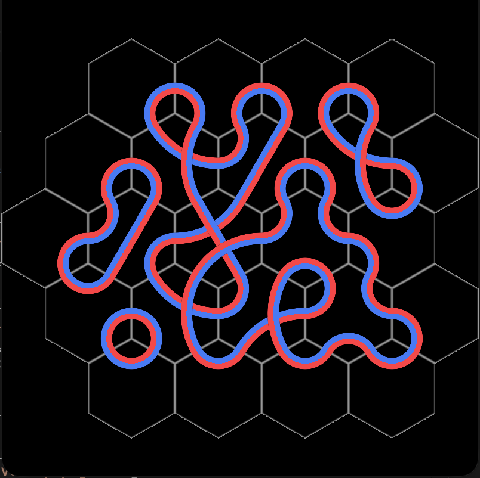 |

## How It Works

### 1. Flat Storage via `jagged_span`
Tilings combine polygons with varying edge counts, such as 12-gons, squares, and hexagons. Instead of nested vectors or pointer indirection, all topology and routing states are stored in contiguous 1D buffers. The custom `jagged_span` view uses layout policies to map tile IDs directly to `{offset, size}`, enabling zero-allocation 2D indexing and subspan access.

### 2. Path Generation & Loop Merging with DSU
Path generation and connecting paths into a single continuous loop rely on a Disjoint-Set Union (DSU) structure tracking edge connectivity:
* **Terminal Pairing**: Each edge of a tile serves as a connection terminal. Terminals inside each tile are connected in pairs either through non-crossing recursive subdivision or random shuffling for overlapping ribbons. Each connection registers the shared global edges into DSU sets using `UnionSets`.
* **Single-Loop Merging (`ConnectPaths`)**: When single-loop mode is enabled, the generator inspects adjacent edge terminals on each tile. If two neighboring paths belong to disjoint cycles (`FindSet(edge_a) != FindSet(edge_b)`), their internal connection partners are swapped to splice the cycles together, unifying them into one continuous loop.

### 3. Bit-Packed GPU Uniform Buffers (UBO)
Routing data is compressed on the CPU and streamed to a single `std140` uniform buffer:
* **8 Bits per Terminal**: 4 bits for the target terminal index, 1 bit to designate which side of the arc is filled, and 3 bits for loop color ID.
* **Shader Unpacking**: Four terminals are packed into each `uint32_t` (aligned into `uvec4` blocks), allowing the fragment shader to unpack routes per pixel and evaluate circular arc distances on the GPU in real time.

## Prerequisites & Dependencies

* **C++23 Compiler**: Clang 16+, GCC 13+, or MSVC 2022+
* **CMake**: Version 3.16 or newer
* **OpenGL**: Version 4.1 Core Profile
* **GLFW3**: Windowing and input management
* **GLM**: OpenGL Mathematics library

## Building & Running

1. **Build**:
   ```bash
   mkdir build && cd build
   cmake ..
   cmake --build .
   ```

2. **Run**:
   The executable accepts an optional path to the directory containing `shader.vert` and `shader.frag` (defaults to `./`):
   ```bash
   ./truchet_grid ../
   ```

3. **Controls**:

   | Key | Action |
   | :--- | :--- |
   | `1`, `2`, `3` | Switch grid topology (1: Dodecagonal, 2: Octagonal, 3: Hexagonal) |
   | `O` | Toggle overlapping ribbons |
   | `L` | Toggle single continuous loop mode |
   | `Arrow Keys` | Adjust grid width and height |

## References

* [Hexagonal Truchet by Shane (ShaderToy)](https://www.shadertoy.com/view/WsyXWR)
* [Dodecagonal Truchet by Shane (ShaderToy)](https://www.shadertoy.com/view/wdBSRm)